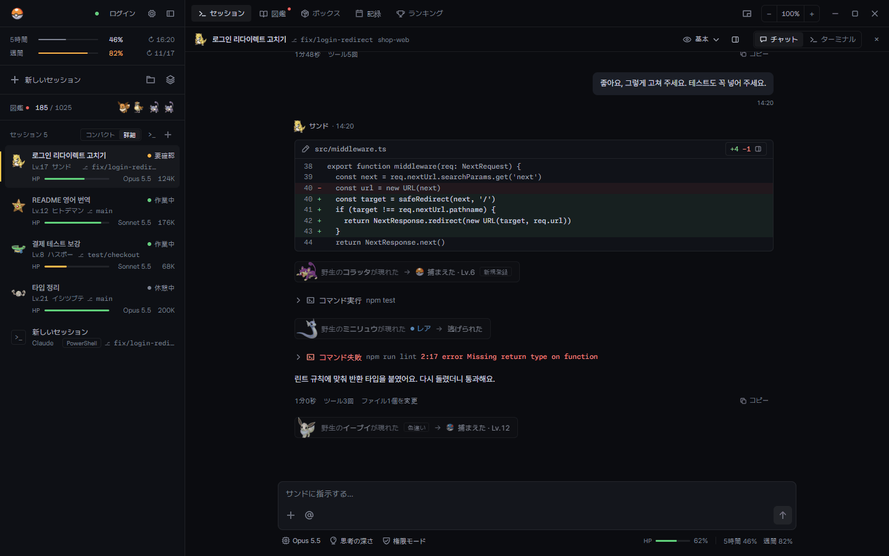
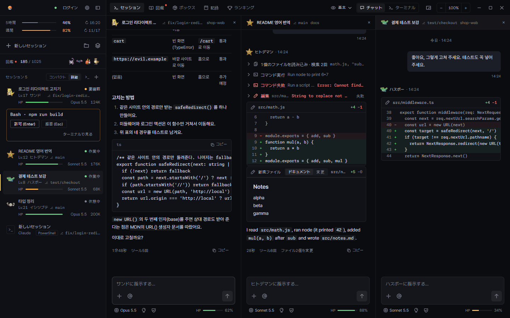
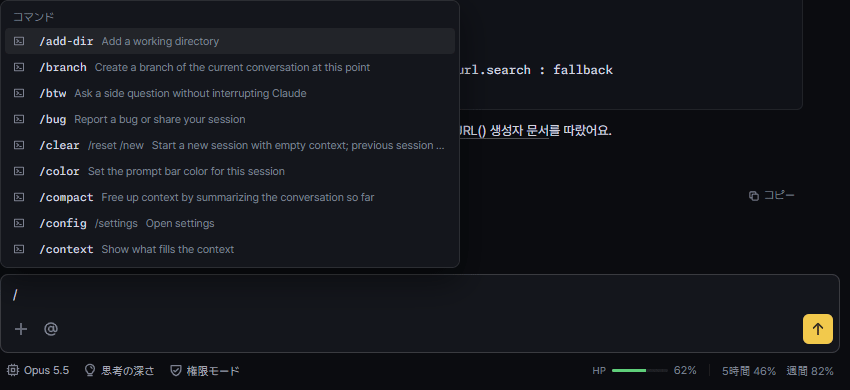
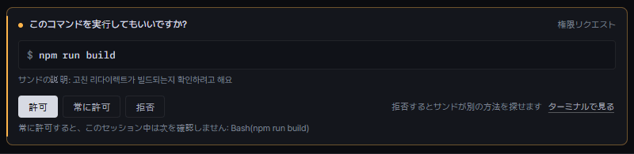
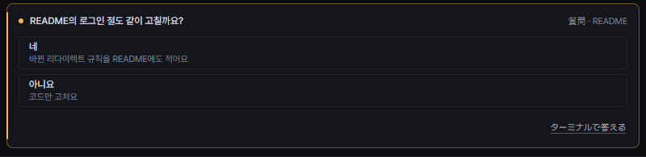
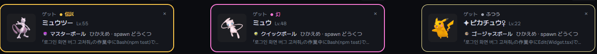
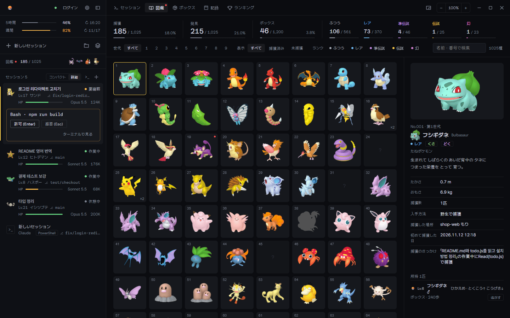
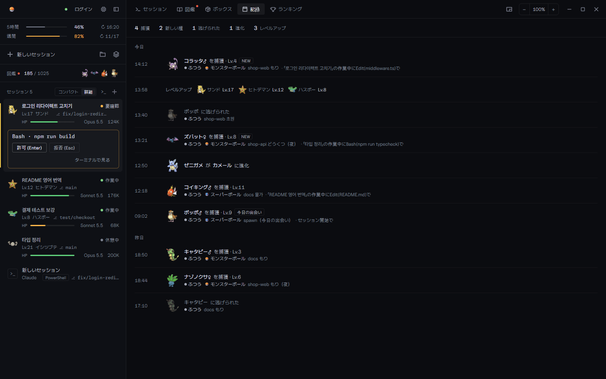
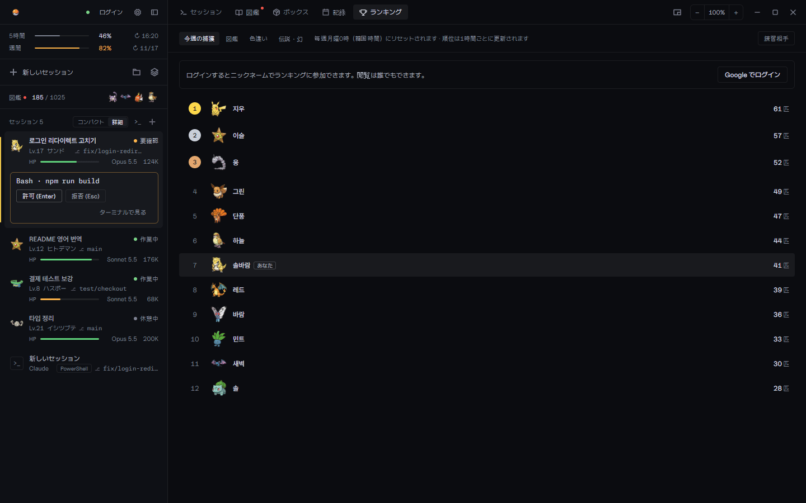
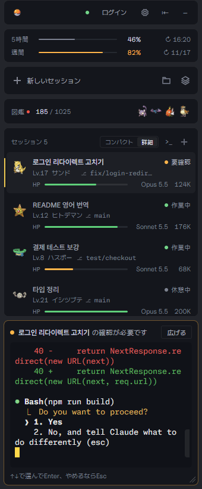

<div align="center">

# spawn

[한국어](README.md) · [English](README.en.md) · **日本語**

Claude Code のセッションをポケモンと一緒に使う Windows · macOS デスクトップアプリです。セッションごとに自分のポケモンが1匹ずつ出て働き、Claude が作業している間に野生のポケモンと出会って図鑑を埋めていきます。バトルはなく、**収集**が中心です。

[](https://github.com/DueStar/spawn/releases/latest)
[](https://github.com/DueStar/spawn/releases)

[](LICENSE)



</div>

> 非営利のファンプロジェクトです。ポケモンに関する名前とイラストの権利は Nintendo / Creatures Inc. / GAME FREAK inc. にあります。詳しくは [NOTICE.md](NOTICE.md) をご覧ください。

## できること

### セッション = ポケモン
- 初回起動時にポケモンを6匹もらいます。1〜9世代の最初のパートナーから1匹と、ふつうランクの5匹で、どれも Lv.5 でモンスターボールに入っています。
- **New session** を押して休んでいるポケモンから好きな1匹を選ぶと(最近使った順、検索もできます)、そのポケモンが新しい Claude Code セッションを担当します。休んでいるポケモンがいないときはポケモンなしでセッションが開き、次に休みに入ったポケモンが担当に加わります。
- セッションは自分のポケモンを覚えています。続きから開くと同じポケモンがまた出てきます。
- セッション名はダブルクリックか ✎ で変えられます。
- 働いているポケモンは、いつでも捕まえた別のポケモンと入れ替えられます。

### チャットで表示と並べて表示
- Claude Code のセッションを会話として表示します(既定)。ターミナルで見たいときは、上の切り替えか、設定 › セッション › 「セッションをチャットで表示」をオフにします。チャット · ターミナルの切り替えはすべてのセッションに一度に適用されます。
- セッションを2〜3個並べて見られます。左のリストからセッションを右側にドラッグするか Ctrl+クリックすると横に枠ができ、枠ごとに会話と入力欄があります。枠の × は枠だけを閉じ、セッションは続きます。
- チャットの入力欄で / を入力するとコマンドの一覧が出ます。標準のコマンドと自分のコマンド・スキルを名前で探して選べます。
- ターミナルに出る選択画面(権限の確認、質問、プランの承認など)がチャットにカードで表示され、押して選べます。

<p align="center">
  
</p>

<table>
  <tr>
    <td width="50%" valign="top"></td>
    <td width="50%" valign="top"><br></td>
  </tr>
  <tr>
    <td align="center"><sub>/ コマンドの一覧</sub></td>
    <td align="center"><sub>権限の確認と質問にチャットでそのまま答えられます</sub></td>
  </tr>
</table>

### 捕獲
- Claude がツールを1回使うたびに1歩です。ツールなしで1分以上考えたり書いたりしても1歩です。1歩ごとに1%の確率で野生のポケモンと出会い、歩数がたまったときは順番に(8秒間隔で)処理されます。
- 毎日最初のセッションでは、まだ捕まえていないポケモンが必ず1匹出ます(今日の出会い)。
- 出会う場所は使うツールで決まります。Edit は草むら、Bash は洞窟、Read は森で、夜はゴースト・あく・エスパータイプが出やすくなります。
- 捕まえると画面の一番上に通知が出ます。どのリクエストでどのツールを使っていたときに捕まえたか、どのボールで捕まえたかも記録されます。

<p align="center">
  
</p>

| 等級 | 出会う確率 | 基準 |
|---|---|---|
| 一般 | 74% | その他のポケモン |
| レア | 21% | 公式の捕獲率45以下(最初のパートナー、600族、化石など) |
| 準伝説 | 3.6% | PokeAPI の `is_legendary` のうちパッケージ伝説でないポケモン |
| 伝説 | 1.0% | パッケージ伝説 |
| 幻 | 0.4% | PokeAPI の `is_mythical` |

- 色違い(✦)が出る確率は1/4096で、まだ捕まえていない種は出やすくなります。

### 個体
- ポケモンごとに性別(種ごとの公式の性比)と性格(公式の25種)があります。
- 本編の進化レベルで進化します(ヒトカゲ16、リザード36など)。成長はポケモンごとに別々に積み重なります。
  - なつき進化: 自分でレベルを20上げたあと、次のレベルアップで進化します。
  - 通信進化: 入れ替えや交換をしたあと、次のレベルアップで進化します。
  - イーブイ: Lv.30から状況に応じて、エーフィ(なつき・昼)、ブラッキー(なつき・夜)、リーフィア(森)、グレイシア(洞窟・夜)、それ以外は石で進化する姿かニンフィアのどれかに進化します。
  - 進化の石による進化は Lv.30(2段階目の進化は40)です。
- 一度捕まえた種は、捕まえるたびに再び出会う確率が10%ずつ下がります(0.9、0.81、…)。下がった分は同じ等級のほかのポケモンに分けられます。
- 捕まったボールは決まった確率で選ばれます。レア度は、ゲームでどれだけ手に入れやすいかを基準に分けています。

| ボール等級 | 確率 | ボール |
|---|---|---|
| よくあるボール | 60% | モンスターボール32、スーパーボール18、ハイパーボール10 |
| 特殊なボール | 29.4% | プレミア4、ネット・ダイブ・ネスト・リピート・タイマー・ダーク・クイック・ヒール各3、ゴージャス1.4 |
| ぼんぐりボール | 8.4% | スピード・レベル・ルアー・ヘビー・ラブラブ・フレンド・ムーンボール各1.2 |
| 限定ボール | 2.0% | サファリ1.2、ウルトラボール0.8 |
| マスターボール | 0.2% | 伝説・幻を捕まえるときは1% |

- コンペボール・パークボール・ドリームボール・プレシャスボールは、ゲームと同じくイベントでしか手に入らないボールなので、野生の捕獲では出ません。
- 条件が合うと、そのボールが出やすくなります。たとえば夜や洞窟(Bash)ではダークボール、検索ツールを使っているときはルアーボール、ウルトラビーストはウルトラボール、長く一緒に働いたポケモンとはゴージャスボール・フレンドボールが出やすくなります。すべての条件は `server/pokedex.js` の `ballBoosts` にあります。
- レベル: 野生のポケモンは Lv.1〜55 で出会います。一緒に働いた時間でレベルが上がります。最初は20分、高いレベルほど長くなって60分ごとに1レベルになり、Lv.100までおよそ55時間です。

### 図鑑とボックス
- **図鑑**: 全1025種を世代・等級別に見られます。捕まえたのにまだ開いていないポケモンには赤い点が付きます。
- **ボックス**: 最大1200匹まで入ります。並べ替え、検索、色違いの絞り込みがあり、逃がすこともできます。いっぱいになると、新しく捕まえたポケモンは図鑑にだけ登録され、博士に送られます。

<p align="center">
  
</p>

<table>
  <tr>
    <td width="50%" valign="top"></td>
    <td width="50%" valign="top"></td>
  </tr>
  <tr>
    <td align="center"><sub><b>記録</b>: 捕獲・逃走・進化・レベルアップを時間順に</sub></td>
    <td align="center"><sub><b>ランキング</b>: 今週の捕獲・図鑑・色違い・伝説と幻</sub></td>
  </tr>
</table>

### アプリ
- **ウィジェット / ウィンドウ / 全画面**: ウィジェットは常に最前面に表示され、ウィンドウと全画面は通常のウィンドウです。全画面はタスクバーの上までを使います。
- **ターミナル**:
  - Shift+Enter または Ctrl+Enter で改行します。
  - リンクは Ctrl+クリックで開きます。
  - ファイルをドラッグ&ドロップするとパスが入力されます。
  - 上のタブをドラッグしてセッションの順番を変えられます。
- **セッションの復元**: アプリを閉じたときに開いていたセッションが、次の起動時にまた開きます(設定でオフにできます)。
- **上限**: 5時間・週間の上限とリセット時刻を表示します。
- **Google ログイン**(任意): 図鑑がクラウド(Supabase)に保存されます。
- **アップデート**: 新しいバージョンが出ると、ウィジェット上部にアップデートボタンが出ます。アプリ部分だけをダウンロードして再起動します。

<p align="center">
  <br>
  <sub>ウィジェットモード</sub>
</p>

## インストール

[Releases](https://github.com/DueStar/spawn/releases/latest) から `spawn-Setup-<バージョン>.exe` をダウンロードして実行します。すぐにインストールされて spawn が起動し、デスクトップとスタートメニューにショートカットができます。

zip でインストールする場合:
1. `spawn-<バージョン>-win-x64.zip` をダウンロードし、好きな場所に展開します。
2. `win-unpacked\spawn.exe` を実行します。

macOS 版(Apple Silicon・Intel)も同じ Releases ページにあります。最初に開くときだけ、システム設定 › プライバシーとセキュリティで「このまま開く」を押してください。Mac ではショートカットの Ctrl の代わりに ⌘ を使います。

必要なプログラムがないときは、アプリがインストール先を案内します。
- [Claude Code](https://docs.claude.com/en/docs/claude-code/setup)(ログイン済み)
- [Git for Windows](https://git-scm.com/downloads/win): Claude Code が Git Bash を使います。

Python など、ほかのプログラムは必要ありません。セッションの記録(フック)は spawn が自分で動かします。

> まだコード署名がありません。SmartScreen の警告が出たら **詳細情報 → 実行** を押してください。Windows 11 のスマート アプリ コントロールがオンだと実行がブロックされます。

ポケモンのイラストはアプリに含まれていません。初めて表示するときに [PokeAPI の画像リポジトリ](https://github.com/PokeAPI/sprites)からダウンロードして `%USERPROFILE%\.spawn\sprites` に保存し、それ以降は保存したファイルを使います。

## しくみ

```
spawn (Electron)
 ├─ ターミナル (node-pty + xterm.js) ── claude --session-id … --settings <spawn 専用のフック>
 │                                          │ フック・ステータスライン
 ├─ ローカルサーバー 127.0.0.1:3334 <────────┘
 │    ├─ セッションの状態、上限
 │    ├─ ゲーム (server/pokedex.js → ~/.spawn/pokedex.json)
 │    ├─ ポケモンのイラスト (server/sprites.js、初めて使うときにダウンロードして保存)
 │    └─ クラウド同期 (server/cloud.js、Supabase)
 └─ ウィジェット / 図鑑 / ボックス / 通知ウィンドウ (React)
```

- **フックは spawn が起動したセッションにだけかかります**: Claude Code のグローバル設定(`~/.claude/settings.json`)には触れません。
- **サーバーはローカルだけで開きます**: `127.0.0.1` でのみ待ち受け、変更するリクエストには `~/.spawn/auth-token` が必要です。
- **アップデートは署名を確認します**: アプリはリリース鍵で署名された `latest.json` だけを受け入れます。
- **データフォルダー**: このアプリは 1.3.35 まで Claudex という名前でした。そのころの `~/.claudex`(1.3.7 までは `~/.agent-office`)と設定フォルダー `%APPDATA%Claudex` は、spawn の初回起動時に `~/.spawn`・`%APPDATA%spawn` へコピーされます。古いフォルダーはそのまま残るので、問題なく動くのを確認してから削除してかまいません。古い環境変数名(`CLAUDEX_PORT`、`CLAUDEX_HOME` など)も引き続き読みます。
- **ログ**: トレイメニューの「ログフォルダを開く」で `spawn.log` を見られます。
- **ログイントークンはサーバーにだけあります**: クラウドのログイントークンは画面側には渡りません。

## 自分のClaude Codeフックと一緒に使う

spawnはClaude Codeを`claude --session-id <id> --settings %APPDATA%\spawn\session-settings.json`で起動します。このファイルにはspawnのフック(イベント16種)とステータスラインが入っていて、アプリを起動するたびに書き直されます。`~/.claude/settings.json`やプロジェクトの`.claude/`の設定には触れません。

- **自分のフックはそのまま動きます**: Claude Codeは各設定にあるフックをまとめて実行するので、spawnのセッションでは自分のフックとspawnのフックが両方動きます。spawnのフックは何も出力せず、いつも成功(終了コード0)で終わるので、自分のフックが返す許可の判断やプロンプトに足す内容は変わりません。ツール呼び出しのフック3つ(PreToolUse・PostToolUse・PostToolBatch)は`async`にしてあるので、Claudeは待ちません。そのほかはspawnのサーバーが止まっていると最大1秒待って先に進みます。
- **ステータスラインはspawnのものになります**: ステータスラインは1つしか使えず、Claude Codeの設定の優先順位では`--settings`がユーザー・プロジェクトの設定より先に来るため、spawnのセッションでは自分のステータスラインの代わりにspawnのもの(`モデル · ctx 42% · $1.23`)が表示されます。spawnはこのステータスラインからコンテキストの使用量と5時間・週間の上限を受け取ります。spawnの外のセッションでは自分のステータスラインがそのまま出ます。
- **spawnが加える環境変数**: spawnのターミナルのClaude Codeセッションにだけ入ります。自分のフックで`SPAWN_SESSION_ID`があれば、spawnの中で動いているセッションです。

| 変数 | 値 |
|---|---|
| `SPAWN_SESSION_ID` | そのターミナルのセッションid。`/clear`で会話が変わっても同じです |
| `SPAWN_LINK_FILE` | `%APPDATA%\spawn\session-links\<セッションid>`。spawnのフックがSessionStartのたびに今の会話idをここに書き、セッションを開き直すとその会話を続けます |

- **外す環境変数**: セッションの環境から`CLAUDECODE`、`CLAUDE_PID`、`CLAUDE_CODE_`で始まる変数を外します。Claude Codeの中からspawnを起動したとき、新しいセッションがそのセッションの子セッションにならないようにするためです。そのため`CLAUDE_CODE_…`をシステムの環境変数にしていても、spawnのセッションには渡りません。
- **spawnの外のセッションは数えません**: 歩数・捕獲・上限はspawnのターミナルで開いたセッションからだけ入ります。ほかのターミナルやIDEで開いたClaude Codeのセッションにはspawnのフックがないので、ポケモンは歩きません。
<!-- Hidden 2026-11-13 with electron/features.json "otherTools": false (bring back together):
- **Codex CLI**: 設定 › AIツールにCodex(`codex`コマンド)を入れると、spawnはCodexが自分で書くセッション記録(`~/.codex/sessions/…jsonl`)を読んでいきます。リクエスト・ツール呼び出し(歩数)・ターンの終わり・モデル・コンテキスト(HP)・Codexの使用量の上限(プランによって5時間・週間・月間)がClaudeのセッションと同じように表示され、アプリを開き直すと同じ会話を`codex resume`で続けます。Codexの設定やログインには触れません。Codexの中で`/new`で新しい会話を始めると、そのタブは最初の会話を追い続けます。
- **ほかのAIツール**: それ以外のツール(Gemini CLIなど)にはフックも上の環境変数も入れません。ターミナルの出力だけで歩数を数えます。
| `%APPDATA%\spawn\session-links\` | ターミナルごとに今続いている会話id(CodexのタブはCodexのスレッドid) |
- 続きから開くセッションの一覧を作るために、`~/.claude/projects`(会話の記録)と`~/.claude/sessions`(実行中のセッション)を読むだけです。Codexのタブが開いているときは、そのタブの記録を見つけるためにその日と前日のCodexの記録の1行目(セッション情報: id・時刻・フォルダ)を読み、見つけた後はそのタブの記録だけを読みます。
-->

## 保存するものと送るもの

### このPCに保存するもの

`~/.spawn`は`%USERPROFILE%\.spawn`です(`SPAWN_HOME`で変えられます)。

| 場所 | 内容 |
|---|---|
| `~/.spawn/pokedex.json` | ゲーム全体: ボックス、図鑑、記録。捕獲の記録には、捕まえたプロジェクトのフォルダ名、使っていたツールと引数の先頭(例: Bashコマンドの先頭32文字)、そのときのリクエストの先頭40文字が入っています |
| `~/.spawn/agents.json` | 今開いているセッションの状態(フォルダ、モデル、最後のリクエスト・返答の先頭200文字など)。サーバーが起動し直しても続けられるように置いています |
| `~/.spawn/usage-limits.json` | 最後に受け取った5時間・週間の使用量とリセット時刻 |
| `~/.spawn/auth-token` | ローカルサーバーのトークン(ランダムな値)。フックと画面がサーバーに頼むときに使います |
| `~/.spawn/cloud-session.json` | Googleログインのセッション。ログインしたときだけあります |
| `~/.spawn/sprites/` | ダウンロードしたポケモンの絵 |
| `%APPDATA%\spawn\settings.json` | 設定 |
| `%APPDATA%\spawn\window-state.json` | ウィンドウの位置・大きさ・モード、セッション名 |
| `%APPDATA%\spawn\open-sessions.json` | 次に起動したとき開き直すセッション(セッションid、フォルダ、ツール) |
| `%APPDATA%\spawn\session-links\` | ターミナルごとに今続いている会話id |
| `%APPDATA%\spawn\session-settings.json` | spawnのセッションに渡すフック・ステータスラインの設定 |
| `%APPDATA%\spawn\logs\spawn.log` | アプリとローカルサーバーのログ |

- 続きから開くセッションの一覧を作るために、`~/.claude/projects`(会話の記録)と`~/.claude/sessions`(実行中のセッション)を読むだけです。
- ローカルサーバーは`127.0.0.1`でだけ開き、フックと画面からの要求は`auth-token`で署名または確認します。
- 設定の「プロンプトを隠す」をオンにすると、画面で隠すほか、クラウドに上げるゲームのコピーからもリクエストの内容とツールの引数を外します(ツール名だけ残ります)。このPCの`pokedex.json`にはそのまま残ります。

### PCの外に出るもの

| いつ | どこへ | 何を |
|---|---|---|
| Googleでログインしているとき、捕獲・進化などの記録が変わると(最大30秒に1回) | Supabase | ユーザーid、表示名(Googleの名前、なければメール)、捕まえた種類の数・見た種類の数、ゲームのコピー。コピーからはこのPCだけが使う値(セッションの割り当て、プロジェクト一覧、今日の捕獲数、セッションの開始時刻)を外し、記録は最新200件だけ上げます。捕獲の記録の中のプロジェクトのフォルダ名はコピーに残ります。ツールの引数の先頭とリクエストの先頭40文字も残りますが、「プロンプトを隠す」がオンなら外して上げます。行レベルセキュリティ(RLS)で本人だけが読み書きできます |
| ランキングを見るとき | Supabase | どの順位表かだけを送ります。ログイン前でも見られ、ログインしていれば自分の順位を探すためにログイン情報が一緒に行きます。受け取るのは公開した参加者のニックネーム、相棒のポケモン、数字だけです |
| ランキングに参加・変更するとき | Supabase | ニックネーム、公開するかどうか、相棒のポケモンの番号。順位の数字(図鑑の数、色違いの数、伝説・幻の数、今週の捕獲)はアプリが送らず、Supabaseが上がったゲームのコピーから計算します。Googleの名前とメールはランキングに出ません |
| ポケモンの絵を初めて見るとき | `raw.githubusercontent.com`(PokeAPIの絵)、`img.pokemondb.net`(ボックスのアイコン) | 絵のアドレスへの要求だけ |
| 起動して15秒後、その後30分ごと | GitHub Releases(`github.com`、だめなら`api.github.com`) | 新しいバージョンの確認(`latest.json`)。アップデートを受け取るときはアプリのファイルをダウンロードします |
| 意見を送るで「送る」を押したときだけ | Supabase(`feedback`表。書き込みだけで、APIからは誰も読めません) | 書いた文、アプリのバージョン、システム(Windowsのバージョン)、言語、そのときの画面名とウィンドウの大きさ、位置を指定したらその要素名。「この部分の画面も一緒に送る」をオンにしたときだけその部分の画像(非公開ストレージ)。誰が送ったか(アカウント)は送りません |

- このほかに利用統計やエラー報告を送るコードはありません。

## 開発

```bash
npm install
npm run dev:electron        # 開発用に起動
npx vitest run tests/pokedex.test.ts tests/sprites.test.ts tests/theme.test.ts
npm test                    # Windows でもすべて通る必要があります
node scripts/release.mjs             # ビルド (release/)、ノートは CHANGELOG.md の "### <バージョン>"
node scripts/release.mjs --publish   # チェックのあと GitHub リリースまで (署名鍵が必要)
```

- **ビルド時に取得する画像**: `tools/fetch-balls.mjs` がボールの画像をダウンロードします。`tools/build-icons.py` はアプリのアイコンを作ります。
- **リポジトリにないもの**: ポケモンとボールの画像はリポジトリに入れません(`.gitignore`)。
- **試験実行**: 実際のデータに触れないようにするには、`SPAWN_HOME=<一時フォルダー> SPAWN_PORT=3344` で起動してください。

```
spawn/
├── electron/      # アプリ: ウィンドウ、ターミナル、アップデート、トレイ
├── server/        # ローカルサーバー: ゲーム、画像、クラウド、セッション
├── src/           # 画面: ウィジェット、図鑑、ボックス、通知
├── hooks/         # Claude Code のフックとステータスライン
├── tools/         # データ・画像の準備スクリプト
├── scripts/       # リリーススクリプト
└── supabase/      # クラウドのテーブル (RLS)
```

## 作者と元になったもの

- [W17ant/Claude-Office](https://github.com/W17ant/Claude-Office)(MIT)をもとに作りました。セッションの追跡、フック、ステータスラインの構造は元のプロジェクトから来ています。
- ポケモンのデータは [PokeAPI](https://pokeapi.co/) から、ボールの画像は [Bulbagarden Archives](https://archives.bulbagarden.net/) から取得しています。

## ライセンス

コードは MIT です。ポケモンの名前とイラストはライセンスの対象外です。[NOTICE.md](NOTICE.md) をご覧ください。
